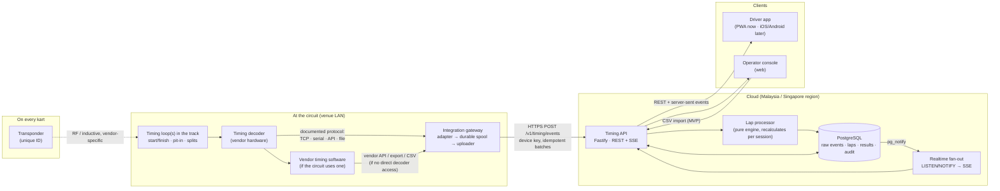

# Architecture

## 1. System architecture



**Status**

| Component | Status |
|---|---|
| Transponder per kart, start/finish timing point | ✅ Confirmed by the brief |
| Decoder protocol, transponder ID format, loop IDs, clock source | ❓ Must obtain from circuit/vendor |
| Whether we get decoder access directly or only via the vendor software | ❓ Must obtain |
| Gateway on a small PC on the venue LAN | 🔶 Assumption (needed for TCP/serial; optional for cloud vendor APIs) |
| Cloud API + PostgreSQL + SSE | ✅ Implemented (`server/`) |
| CSV import as the first integration path | ✅ Implemented and tested |
| Phones never read transponders | ✅ Confirmed design constraint: phones only show data the timing system recorded |

### Why this shape

- **Adapters at the edge, one lap engine in the middle.** Every timing provider is different, so
  vendor-specific code lives only in a gateway adapter that turns the vendor's messages into a
  *normalised passing* (transponder, loop, timestamp, idempotency key). All lap logic runs once,
  centrally, so it behaves the same whatever the source: CSV, vendor API or a raw decoder.
- **Raw events are the source of truth.** Laps and results are *derived* and can be rebuilt at any
  time. Corrections never edit raw data (enforced by a database trigger).
- **Store-and-forward at the track.** Venue internet drops. The gateway writes every passing to
  local disk before uploading, and the API dedupes on `(device, eventKey)`, so retries are safe.

### Recommended technology stack

| Layer | Choice | Why |
|---|---|---|
| Backend | Node.js 22 + TypeScript + Fastify 5 | One language across gateway, API and apps; Fastify is fast and simple; good TCP/serial libraries for adapters |
| Database | PostgreSQL 16 | Range types + exclusion constraints guarantee a transponder is never in two places at once; transactional recalculation; mature managed hosting |
| Validation | zod | Request validation shared with typed clients |
| Auth | JWT (HS256 via `jose`) for users; hashed API keys for timing devices | Simple, stateless; device keys revocable per device |
| Realtime | Server-sent events, fanned out with Postgres `LISTEN/NOTIFY` | One-way updates are all live timing needs; works through proxies; no extra broker for the MVP |
| Driver app | React (PWA) now → **React Native / Expo** for store apps | Reuse API client and components; Expo gives push notifications and OTA updates |
| Operator console | React web app (same codebase as the PWA today) | Runs on any trackside PC or tablet |
| Gateway | Node.js service on a fanless mini-PC (or the timing PC) | Same code as the server; runs as a system service |
| Tests | Vitest against a real PostgreSQL | Exclusion constraints and triggers can't be faked with mocks |

Alternatives considered: a message broker (Kafka/NATS) is unnecessary at single-venue volumes (a 2-hour,
30-kart endurance race is about 4,000 events); add one only for many venues or analytics streaming.
Firebase-style backends make it hard to enforce timing invariants (immutability, non-overlapping assignments) in the database.

## 2. End-to-end data flow

```mermaid
sequenceDiagram
  autonumber
  participant D as Driver
  participant O as Operator
  participant T as Transponder + loop
  participant DEC as Decoder
  participant GW as Gateway
  participant API as API + lap engine
  participant DB as PostgreSQL
  participant APP as Driver app

  D->>O: Books / registers for a session
  O->>API: Create session, assign driver → kart
  API->>DB: Participant + kart (transponder resolved from assignment history)
  O->>API: Start session (green flag)
  API->>DB: Snapshot transponders, open time ranges, record clock offset
  loop Every line crossing
    T->>DEC: Kart passes loop
    DEC->>GW: Passing (transponder, loop, time, sequence)
    GW->>GW: Append to disk spool
    GW->>API: POST /v1/timing/events (batch, eventKey)
    API->>DB: INSERT … ON CONFLICT DO NOTHING (raw, immutable)
    API->>DB: Recalculate affected session (laps, standings)
    DB-->>API: NOTIFY session_results
    API-->>APP: SSE "results changed" → app refetches (status: Live)
  end
  O->>API: Finish (chequered flag)
  Note over API: Each kart's next crossing completes its last lap
  API-->>APP: Status: Provisional
  O->>API: Review anomalies, apply corrections (audited)
  O->>API: Finalise
  API->>DB: Final results; personal bests, leaderboards and records include them
  API-->>APP: Status: Final · "Your results are ready" notification (Phase 3)
```

Mapping events to drivers, step by step:

1. A passing carries only a **transponder code** (never a driver).
2. `transponder_assignments` says which **kart** carried that transponder at that instant (time ranges, history kept).
3. `participant_karts` says which **session participant** was using that kart/transponder at that instant
   (time ranges; a kart swap mid-session closes one range and opens another).
4. The participant is a **driver**, or a **team** whose current driver comes from **stints** recorded by the pit-lane operator.

So the system never identifies a driver from a transponder alone, and reassigning a transponder after
maintenance never rewrites history.

## 12. Deployment

See [10-deployment.md](10-deployment.md).
