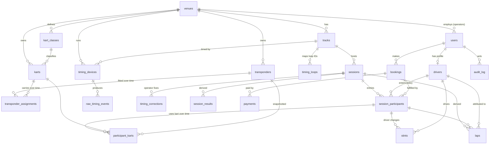

# Database

PostgreSQL 16. Business entities use `uuid` keys; high-volume event rows use `bigserial`. Timing instants
are stored as `bigint` **microseconds since the epoch in the timing device's clock** (`*_us`), so no
precision is lost and comparisons are exact.

## 4. Schema and relationships



### Entities

| Table | Purpose | Key rules |
|---|---|---|
| `venues` | A karting circuit/business | Has an IANA time zone (default `Asia/Kuala_Lumpur`) for local-day leaderboards |
| `users` | Login accounts | Roles `driver`, `operator`, `admin`; operators are scoped to one venue; scrypt password hashes |
| `drivers` | Driver profiles | Can exist **without** an account (walk-in) and be linked later; `show_on_leaderboards` privacy flag |
| `tracks` | One row per **layout** | Records are only compared within a layout; default lap rules per track |
| `timing_loops` | Decoder loop ID → role (`finish`, `pit_in`, `pit_out`, `split`) | Unknown loop IDs are ignored and reported |
| `kart_classes`, `karts` | Kart inventory | Kart status `active`/`maintenance`/`retired` |
| `transponders` | Transponder inventory | `code` exactly as the decoder reports it |
| `transponder_assignments` | Which kart carries which transponder, **over time** | `tstzrange` + two exclusion constraints: a transponder is on one kart at a time, a kart has one transponder at a time; history never overwritten |
| `timing_devices` | Decoders / gateways / CSV import source | SHA-256 hashed API key; last seen; clock offset; last sequence |
| `sessions` | A timed session | Type (practice, rental, qualifying, sprint, endurance), status lifecycle, lap rules, clock offset snapshot |
| `session_participants` | An entry: solo driver or team | Linked to an optional booking |
| `participant_karts` | Which kart/transponder an entry used, **over time** | Transponder snapshotted at start; exclusion constraint guarantees one transponder ↔ one participant at any instant, across all sessions |
| `stints` | Endurance driver changes | Recorded by the pit-lane operator; laps attributed by lap end time |
| `raw_timing_events` | Every passing as received | **Append-only** (trigger rejects UPDATE/DELETE); unique `(device_id, event_key)` for idempotency |
| `timing_corrections` | Operator corrections | Append-only; withdrawn by `revoked_*`, never deleted; always has a reason |
| `laps` | Derived lap records | Rebuilt from raw events + corrections; flags and validity |
| `session_results` | Derived standings | Provisional or final according to `sessions.status` |
| `bookings`, `payments` | Optional booking module | Amounts in sen (integer); provider reference only, never card data |
| `audit_log` | Who changed what, when, why | Before/after JSON; actor user or device |

Leaderboards, personal bests and track records are **queries over final laps** (indexed), not
stored tables, so a reopened and corrected session updates them automatically. 🔶 At larger scale,
materialise them on finalisation (see [roadmap](12-roadmap.md)).

## 5. Migrations

Plain SQL files applied in order by `server/src/migrations.ts`. Each file runs in a transaction,
an advisory lock stops concurrent runners, and applied files are recorded in `schema_migrations`.

- [`001_core.sql`](../server/migrations/001_core.sql): everything above except bookings.
- [`002_bookings.sql`](../server/migrations/002_bookings.sql): optional bookings and payments.

Key excerpts:

```sql
-- A transponder can be on only one kart at a time, and vice versa; history is kept.
CREATE TABLE transponder_assignments (
  id             uuid PRIMARY KEY DEFAULT gen_random_uuid(),
  transponder_id uuid NOT NULL REFERENCES transponders(id),
  kart_id        uuid NOT NULL REFERENCES karts(id),
  valid_during   tstzrange NOT NULL,
  EXCLUDE USING gist (transponder_id WITH =, valid_during WITH &&),
  EXCLUDE USING gist (kart_id WITH =, valid_during WITH &&)
);

-- Raw events: idempotent and immutable.
CREATE TABLE raw_timing_events (
  id               bigserial PRIMARY KEY,
  device_id        uuid NOT NULL REFERENCES timing_devices(id),
  event_key        text NOT NULL,
  transponder_code text NOT NULL,
  loop_code        text NOT NULL,
  detected_us      bigint NOT NULL,
  detected_at      timestamptz GENERATED ALWAYS AS (to_timestamp(detected_us / 1000000.0)) STORED,
  UNIQUE (device_id, event_key)
);
CREATE TRIGGER raw_timing_events_immutable BEFORE UPDATE OR DELETE ON raw_timing_events
  FOR EACH ROW EXECUTE FUNCTION forbid_raw_event_changes();
```

Commands:

```bash
npm run migrate -w @pinnacle/server     # apply pending migrations (also runs on API start)
```

Rules for new migrations: never edit an applied file; add `003_….sql`. Prefer additive changes. For
destructive changes, deploy in two steps (stop using the column, then drop it).

### Data retention

🔶 Raw events: keep indefinitely (small: about 100 bytes/row; roughly 1–2 million rows/year for a busy venue).
🔶 Personal data: delete or anonymise driver profiles on request (PDPA); results stay with the name replaced by "Deleted driver".
❓ Confirm retention requirements with the circuit.
