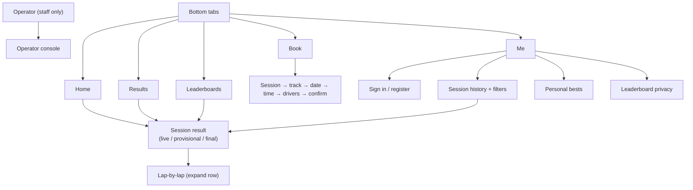

# 9. Mobile application: screens & navigation

**Delivery plan:** the MVP is a mobile-first **web app (PWA)**, installable to the home screen and
built in `web/`. Phase 3 wraps the same API client and screens in **React Native (Expo)** for the App
Store and Google Play, adding push notifications and offline caching. ✅ The app never detects
transponders; it only shows what the timing system recorded.

## Navigation



## Screens

| Screen | Content | Status |
|---|---|---|
| **Home** | Greeting, "On track now" live sessions, your personal bests, latest results, booking entry point | ✅ PWA |
| **Results** | Track filter; live sessions first; recent sessions with status badges | ✅ |
| **Session result** | Status banner explaining live/provisional/final; standings (position, kart, driver/team, best lap or laps, average, gap); fastest lap in purple; tap a row for lap-by-lap bars with best/invalid/pit/start markers; updates live over SSE | ✅ |
| **Leaderboards** | Track/layout chips; Today / This week / This month / All time; track record cards per kart class; class filter appears automatically when classes are mixed, with a comparability note | ✅ |
| **Me: signed out** | Sign in / create account | ✅ |
| **Me: driver** | Name, public-leaderboard toggle, sessions/wins/podiums, personal bests per track and class, session history filtered by venue, session type, kart number and date range | ✅ |
| **Venue selection** | Venue chips on Results and Leaderboards (from `GET /venues`) | ✅ basic; dedicated picker Phase 3 |
| **Driver & kart comparison** | Compare your laps with another driver in the same session; your average per kart number | Phase 3 |
| **Event announcements** | Race nights, championships, track closures (operator-authored) | Phase 3 |
| **Notifications** | "Your results are ready" when a session you drove is finalised; new PB; booking reminders | Phase 3 (Expo push) |
| **Book** | Session type, track, date strip, hourly slots with availability, number of drivers, confirmation with check-in code | 🔶 Demo only (device storage); real bookings in Phase 4 |

## Lap time formatting

- `m:ss.fff` when a minute or longer (`1:00.900`), `ss.fff` otherwise (`43.772`). Truncated, never rounded, as timing screens do.
- Gaps: `+0.768`; lapped: `+1 lap`.
- Tabular monospace digits so columns line up.

## Design notes

- Dark theme for readability at the track; bottom tab bar on phones, top navigation on desktop.
- Status is always visible and colour-coded: green **Live** (pulsing dot, disabled for reduced-motion users), amber **Provisional**, neutral **Final**.
- The driver's own row is highlighted in green everywhere.
- Private drivers appear as "Private driver" to others.

## React Native (Phase 3) structure

```
app/(tabs)/index.tsx          Home
app/(tabs)/results/[id].tsx   Session result (SSE via react-native-sse)
app/(tabs)/ranks.tsx
app/(tabs)/me.tsx
app/admin/…                   (staff: optional; console stays web-first)
lib/api.ts                    shared with web (same types and calls)
```

Push: Expo Notifications → APNs/FCM; tokens stored per user; sent by the finalisation hook.
